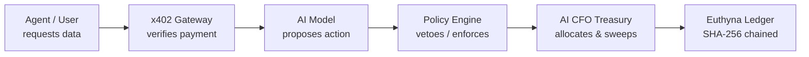

# QMA — Financial Intelligence Marketplace & Autonomous AI CFO on Arc 🏛️

**The autonomous quantitative intelligence marketplace and self-governing corporate treasury on Arc: quant creators monetize signals, autonomous AI agents purchase verified market memory per query via Circle x402 USDC micropayments, and an autonomous AI CFO governs protocol balance sheets with automated USYC yield sweeps.**

[](https://qma-three.vercel.app/)
[](https://driveway-expansive-onyx.ngrok-free.dev/docs)
[](https://docs.arc.network)
[](https://github.com/circlefin)
[](https://www.npmjs.com/package/@hoanlv214/qma-cli)
[](scripts/run_backend_local.py)
[](docs/audit/SECURITY_AND_AUDIT_REPORT.md)
[](LICENSE)

---

## Quick Links

**[Live Marketplace & Treasury Radar](https://qma-three.vercel.app/)** · **[OpenAPI Documentation](https://driveway-expansive-onyx.ngrok-free.dev/docs)** · **[Technical Whitepaper](docs/whitepaper/QMA_WHITEPAPER.md)** · **[Security & Audit Report](docs/audit/SECURITY_AND_AUDIT_REPORT.md)** · **[Policy vs Model Research](docs/research/POLICY_VS_MODEL.md)** · **[Local Operator Guide](docs/operations/LOCAL_DEVELOPMENT.md)**

---

## How to Evaluate QMA in 3 Minutes (No Wallet Required)

Everything below runs against the live deployment without requiring any private key, crypto wallet, or upfront payment:

1. **Explore Live Market Anomalies**: Visit **[qma-three.vercel.app](https://qma-three.vercel.app/)** to inspect real-time quantitative anomaly feeds ingested from live orderbooks (OKX/MEXC Funding Disparity, Open Interest Regime Shifts, Liquidation Radar).
2. **Inspect an x402 Nanopayment Challenge**: Query any premium report endpoint (e.g. `GET /api/v1/reports/funding-rates/sample`). The gateway responds with standard `HTTP 402 Payment Required` headers containing dynamic pricing ($0.002 Preview / $0.005 Full Report) and EIP-712 settlement parameters.
3. **Inspect the AI CFO Treasury Console**: Open the Treasury Radar to view protocol balance sheet allocations: liquid operational cash reserves, ring-fenced creator liabilities (80% revenue share), and automated idle-cash allocation into the ERC-4626 USYC Yield Vault.
4. **Trigger a JIT (Just-In-Time) Cashflow Cycle**: Observe how the autonomous CFO redeems vault shares dynamically when creator claims or operating payables fall due, maintaining 100% solvency without manual human intervention.
5. **Verify the Cryptographic Audit Chain**: Verify the Euthyna SHA-256 hash-chain (`POST /api/v1/treasury/audit/verify`) to confirm that every data purchase, treasury sweep, and creator payout is sequentially linked and cryptographically untampered.

---

## The Core Problem & Solution

### The Two Broken Paradigms

1. **The Data Monopoly Problem for Autonomous Agents**: Modern AI trading agents and algorithmic bots cannot open traditional corporate bank accounts or pay $1,000–$2,500/month recurring SaaS subscriptions (Bloomberg, Nansen, Glassnode) for occasional data lookups. They need machine-readable, structured JSON market intelligence **paid per query in sub-cent stablecoins**.
2. **The Monetization Barrier for Quant Researchers**: Mathematical researchers and quant developers build high-signal alpha models (cross-market basis, funding rate divergence) but lack the infrastructure to package, bill, and sell individual signal inferences to autonomous software buyers.
3. **The Idle Capital Problem for Web3 Protocols**: Protocols that collect stablecoin fees typically let operational cash sit idle at 0% return in hot wallets or lock it in rigid staking vaults that cause insolvency during sudden payout spikes.

### The QMA Closed-Loop Flywheel

QMA solves this through a unified, self-sustaining financial architecture:

```text
 ┌────────────────────────────────────────────────────────────────────────┐
 │                      FRONT-OFFICE: THE MARKETPLACE                     │
 │  • Quant Creators publish models (Funding, Basis, Liquidation Radar)   │
 │  • Autonomous AI Agents buy intelligence per query via Circle x402    │
 │  • Zero subscription lock-in: $0.002 Preview / $0.005 Full Report      │
 └───────────────────────────────────┬────────────────────────────────────┘
                                     │ (USDC Inflow)
                                     ▼
 ┌────────────────────────────────────────────────────────────────────────┐
 │                   BACK-OFFICE: AUTONOMOUS AI CFO                       │
 │  1. Segregate Liabilities: Ring-fences 80% revenue for Creator Wallets │
 │  2. Operating Buffer: Holds deterministic 7-day OpEx liquid buffer     │
 │  3. Yield Optimization: Sweeps surplus cash into ERC-4626 USYC Vault   │
 │  4. JIT Liquidity: Auto-redeems USYC to USDC when Creators claim funds │
 │  5. Hard Guardrails: Spending policies & circuit breakers overrule LLM │
 └───────────────────────────────────┬────────────────────────────────────┘
                                     │ (Cryptographic Attestation)
                                     ▼
 ┌────────────────────────────────────────────────────────────────────────┐
 │                  AUDIT TRAIL: EUTHYNA SHA-256 CHAIN                    │
 │   Every query invoice, treasury sweep, policy veto, and claim payout   │
 │   is signed and chained into a tamper-evident PostgreSQL audit trail   │
 └────────────────────────────────────────────────────────────────────────┘
```

---

## What QMA Does: Complete Capabilities Matrix

| Area | What the Platform Does | Code Implementation | Status & Evidence |
| :--- | :--- | :--- | :--- |
| **Market Intelligence** | Ingests real-time orderbook depth, funding disparity, and open interest dynamics across derivatives exchanges, calculating Mahalanobis Z-scores and liquidation regimes. | `backend/app/services/anomaly_detector.py` | `[Implemented]` Live feeds active |
| **Circle x402 Payments** | Issues HTTP 402 challenge with EIP-712 payment authorization, replay defense, and idempotency tracking. | `backend/app/services/x402_gateway.py` | `[Implemented]` Protocol-level |
| **Creator Monetization** | Creators register schemas, set pricing, and earn an automated 80% revenue split on every paid query. | `backend/app/services/creator_claims.py` | `[Implemented]` Live claim ledger |
| **Pull-Payment Claims** | Creators claim accrued earnings non-custodially via signed cryptographic proofs (`POST /api/v1/creators/claim`). | `backend/app/services/creator_claims.py` | `[Implemented]` Pull-payment safety |
| **Autonomous AI CFO** | Cash-flow forecaster, runway calculator, and liquidity allocator evaluating balance sheet health. | `backend/app/services/usyc_treasury.py` | `[Implemented]` Dual-mode (Policy/LLM) |
| **USYC Yield Sweeper** | Automated sweep of surplus cash above operating reserve into tokenized USYC vault on Arc. | `contracts/USYCVault.sol` | `[Implemented]` Testnet Contract `0x934e...` |
| **JIT Redemption** | Automatically burns vault shares to redeem USDC ahead of creator payouts or incoming bills. | `backend/app/services/usyc_treasury.py` | `[Implemented]` Verified on-chain tx |
| **Policy vs Model** | Deterministic hard constraints in Python/contracts strictly overrule LLM proposals. | `backend/app/services/policy_vs_model.py` | `[Implemented]` Recorded override log |
| **Euthyna Audit Trail** | Every state transition is SHA-256 hash-chained with context, parent hash, and timestamp in PostgreSQL. | `backend/app/services/euthyna_audit.py` | `[Implemented]` 252,594 chained records |
| **Agent CLI & MCP** | Canonical CLI and Model Context Protocol (MCP) server for external autonomous agents. | `agents/bin/qma.js` & `backend/app/mcp` | `[Implemented]` `@hoanlv214/qma-cli` |

---

## Safety Architecture & Invariants



| Safety Layer | Invariant Guaranteed |
| :--- | :--- |
| **Guardrails in Code** | Hard limits on single-transaction sweep/redeem, minimum liquidity buffer, and cooldown periods run as deterministic Python code. A refusal records the model's proposal and the exact rule that overruled it. |
| **Ring-Fenced Creator Liabilities** | 80% of query revenue is segregated for creator claimability and is never locked in long-term illiquid positions. |
| **Agent Spending Limit** | Autonomous client agents enforce daily and per-transaction USDC spending caps (`spending_policy.py`). |
| **Emergency Circuit Breaker** | An operator or autonomous policy can trigger `treasury_halted=True` to immediately freeze all outbound sweeps while keeping creator claims operational. |
| **Exactly-Once Settlement** | Database claims make payment execution exclusive; EIP-712 nonces and idempotency keys prevent duplicate billing or replayed transactions. |
| **Tamper-Evident Audit Trail** | Every invoice, treasury sweep, policy veto, and claim payout is signed and covers the SHA-256 hash of the entry before it. |

---

## Empirical Verification & Usage Snapshot

Figures are queried directly from the local PostgreSQL storage engine (`scripts/run_backend_local.py`). Arc Testnet history and Arc Mainnet production records are kept strictly isolated:

| Metric / Artifact | Arc Testnet (`qma` DB) | Arc Mainnet (`qma_mainnet` DB) | Verification Source / Table |
| :--- | :--- | :--- | :--- |
| **Total Payment Events** | **1,745 events** | **0 events** *(Genesis Live)* | PostgreSQL `qma_payment_events` |
| **Generated Invoices** | **2,772 invoices** | **0 invoices** *(Genesis Live)* | PostgreSQL `qma_invoices` |
| **Paid Reports Delivered** | **1,094 reports** | **0 reports** *(Genesis Live)* | PostgreSQL `qma_paid_reports` |
| **Euthyna Audit Trail** | **252,594 records** | **0 records** *(Genesis Live)* | PostgreSQL `euthyna_audit_trail` (SHA-256 chained) |
| **Agent Sessions Recorded** | **96 sessions** | **0 sessions** *(Genesis Live)* | PostgreSQL `agent_sessions` |
| **Schema Migrations** | **16 / 16 applied** | **16 / 16 applied** | PostgreSQL `schema_migrations` |
| **Underlying Token (USDC)** | `0x3600...0000` | Native Gas USDC | [Arcscan Token Contract](https://testnet.arcscan.app/address/0x3600000000000000000000000000000000000000) |
| **USYC Yield Vault (ERC-4626)**| `0x934e...fcb2` | Ready for deployment | [Arcscan Vault Contract](https://testnet.arcscan.app/address/0x934e7309d7fca371db946b0643f2136cc0a0fcb2) |
| **Autonomous Sweep Deposit** | Confirmed (Block #62679606) | — | [Arcscan Tx: 0xd9b3...edec](https://testnet.arcscan.app/tx/0xd9b31a246f0df00e08ceaf40b0f2892305bc820f0f9e8d0e7717b0b04e18edec) |
| **Just-In-Time (JIT) Redemption**| Confirmed (Block #62679616) | — | [Arcscan Tx: 0x705c...9629](https://testnet.arcscan.app/tx/0x705c9e4b3ee7a99159082c8f800bb8fb6916e2acbc33f4743a33ca9a81e29629) |

---

## Developer & Agent Integration

### 1. Canonical Agent CLI (`qma`)

Autonomous agents can buy quantitative intelligence from the command line:

```bash
# Via npx (zero installation)
npx @hoanlv214/qma-cli agent run --task "funding anomaly watchlist" --budget 0.05 --json

# Direct execution
node agents/bin/qma.js agent run --task "basis arbitrage" --budget 0.02
```

### 2. Model Context Protocol (MCP) Integration

External AI environments (Claude, Cursor, Devin) can query QMA directly via MCP:

```json
{
  "mcpServers": {
    "qma": {
      "command": "node",
      "args": ["agents/bin/qma.js", "mcp"]
    }
  }
}
```

### 3. REST API & Circle x402 Headers

External HTTP clients query endpoints via standard HTTP 402:

```bash
# 1. Request report quote
curl -i https://qma-three.vercel.app/api/v1/reports/funding-rates/sample

# Response: HTTP 402 Payment Required
# Headers:
#   x-qma-payment-required: true
#   x-qma-price-usdc: 0.005
#   x-qma-recipient: 0xf5987818EBBEe812EB730B6a395d66e664412cf5

# 2. Retry with signed EIP-712 payment authorization
curl -H "X-PAYMENT: <signed_authorization_payload>" \
     https://qma-three.vercel.app/api/v1/reports/funding-rates/sample
```

---

## System Architecture

```text
CLIENTS & AGENTS                      AUTONOMOUS BACKEND CORE                    ARC L1 & SETTLEMENT
────────────────                      ───────────────────────                    ───────────────────
┌──────────────────┐                  ┌───────────────────────────────┐          ┌──────────────────────┐
│ Treasury Radar   │                  │ FastAPI REST API Engine       │          │ USYC Yield Vault     │
│ React 19 + Vite  │ ─── HTTP / SSE ─▶│                               │ ── EVM ─▶│ (ERC-4626)           │
│                  │                  │  • Quant Anomaly Evaluator    │          │ 0x934e...            │
└──────────────────┘                  │  • x402 Micropayment Gateway  │          └──────────┬───────────┘
                                      │  • Autonomous AI CFO Service  │                     │
┌──────────────────┐                  │  • Euthyna Hash-Chain Audit   │                     │ Target APY
│ Autonomous Agent │                  └──────────────┬────────────────┘                     ▼
│ Canonical CLI    │                                 │                   ┌──────────────────────┐
│ (qma / qma-cli)  │ ─── EIP-712 x402 ───────────────┼──────────────────▶│ Native USDC Token    │
└──────────────────┘                                 │                   │ 0x3600...            │
                                                     ▼                   └──────────────────────┘
                                      ┌───────────────────────────────┐
                                      │ Self-Hosted PostgreSQL        │
                                      │  • Mainnet Genesis (Port 8000)│
                                      │  • Testnet Sandbox (Port 8001)│
                                      └───────────────────────────────┘
```

---

## Production Deployment

- **Frontend Tier**: Next.js / Vite SPA deployed on Vercel at [`https://qma-three.vercel.app`](https://qma-three.vercel.app).
- **Backend Tier**: FastAPI backend running Python 3.12 with async workers on Render / Linux server.
- **Database Tier**: Production PostgreSQL instance with 16 forward-only migrations.
- **Settlement Tier**: Arc L1 (Chain ID `5042` Mainnet / `5042002` Testnet).
- **Local Development**: See [`docs/operations/LOCAL_DEVELOPMENT.md`](docs/operations/LOCAL_DEVELOPMENT.md) for local multi-environment dashboard and runner instructions.

---

## Repository Structure

```text
qma/
├── agents/                  # Canonical Agent CLI and autonomous session runners
│   ├── bin/qma.js           # Canonical CLI: $ qma agent run [options]
│   └── bin/agent_buyer.js   # Autonomous purchase and treasury execution engine
├── backend/                 # Authoritative FastAPI REST API & Autonomous Financial Core
│   └── app/
│       ├── api/v1/          # Endpoints: /reports, /treasury, /creators, /agent
│       ├── core/            # Config, multi-DB URL resolution, and security guardrails
│       ├── repositories/    # PostgreSQL storage backend with full transaction safety
│       ├── schemas/         # Pydantic v2 data models and OpenAPI schemas
│       └── services/        # usyc_treasury.py, x402_gateway.py, euthyna_audit.py
├── contracts/               # Smart Contracts on Arc L1
│   ├── USYCVault.sol        # ERC-4626 Yield Vault on Arc Testnet
│   └── GenQMAShield.py      # SLA Verification Contract on GenLayer
├── docs/                    # Architectural specifications and verification reports
│   ├── api/README.md        # Complete OpenAPI route inventory & security docs
│   ├── architecture/        # Controlled Refactoring Protocol (CRCIP)
│   ├── audit/               # Formal Threat Model and Security Assessment Report
│   ├── operations/          # Local development and operator dashboard guide
│   └── research/            # Policy vs Model: empirical guardrail override logs
├── frontend/                # Vite + React 19 Treasury Radar & Market Explorer
├── scripts/                 # Operational tooling: DB Migrations, Local Run, Control Center
├── main.py                  # Root entrypoint shim for Render cloud deployment
└── pyproject.toml           # Authoritative Python dependencies (managed via uv)
```

---

## License

This project is licensed under the MIT License — see the [LICENSE](LICENSE) file for details.
