# Kiến trúc luồng hệ thống QMA (System Flow Diagrams)

Dưới đây là sơ đồ chi tiết hoá 2 luồng quan trọng nhất trong hệ thống QMA hiện tại, được vẽ dựa trên **chính source code và 4 lớp bảo mật** mà chúng ta đã thiết lập.

---

## 1. Luồng 1: Provider Onboarding & Webhook Execution (Bên cung cấp Data)

Đây là luồng mô tả vòng đời của một Provider: từ lúc điền form đăng ký API của họ lên QMA, cho đến khi QMA (với tư cách là Marketplace Core) gọi API của họ một cách an toàn.

```mermaid
sequenceDiagram
    autonumber
    actor Provider as 3rd Party Provider
    participant UI as Marketplace UI
    participant Admin as QMA Admin (Review)
    participant Core as QMA Core (ProviderRegistryV2)
    participant Adapter as WebhookProviderAdapter (Layer 2)
    participant Webhook as Provider's Server (API)

    %% Đăng ký và Phê duyệt
    rect rgb(30, 40, 50)
    Note over Provider, Core: Giai đoạn 1: Onboarding & Registration (Layer 1 Security)
    Provider->>UI: Submit Form (Name, Webhook URL, USDC Wallet, Schema)
    UI->>Core: POST /api/v1/market/apply (Lưu draft)
    Admin->>Core: Audit URL (Chặn 127.0.0.1, Local IP)
    Admin->>Core: Approve & Register to ProviderRegistryV2
    end

    %% Quá trình gọi API an toàn
    rect rgb(20, 50, 40)
    Note over Core, Webhook: Giai đoạn 2: Runtime Execution (Layer 2 Security)
    Core->>Adapter: GET /manifest
    Adapter-->>Core: Trả về UI Schema động để render form

    Note over Core, Adapter: Khi có Agent muốn lấy báo giá (Score)
    Core->>Adapter: score(context)
    
    Adapter->>Adapter: Ký HMAC-SHA256 (X-QMA-Signature)
    Adapter->>Adapter: Phân giải DNS (Chống DNS Rebinding)
    Adapter->>Webhook: HTTP POST /score (Kèm Timeout 3s)
    Webhook-->>Adapter: JSON (amount_usdc, confidence)
    
    Note over Adapter: Kiểm tra giới hạn 1MB Response Bomb
    Adapter-->>Core: Trả báo giá chuẩn hoá
    end

    %% Trả kết quả
    rect rgb(50, 30, 40)
    Note over Core, Webhook: Giai đoạn 3: Data Delivery (Opaque Payload)
    Core->>Adapter: deliver(context)
    Adapter->>Webhook: HTTP POST /deliver (Timeout 15s)
    Webhook-->>Adapter: Raw Data Payload
    Note over Adapter: Gói gọn trong 'payload' (Không cho phép ghi đè Status/Price)
    Adapter-->>Core: Trả về data an toàn
    end
```

### 🔍 Giải thích chi tiết Luồng 1:
- **Bước 1-4 (Onboarding):** Provider không còn code trực tiếp trong Repo của QMA nữa. Họ đăng ký URL bên ngoài. QMA Admin sẽ kiểm duyệt và đưa vào `ProviderRegistryV2`.
- **Bước 7-12 (Runtime Security):** Khi QMA cần lấy giá (Score), nó đi qua `WebhookProviderAdapter`. Tại đây, các lớp khiên như **HMAC, Chặn DNS Rebinding, Timeout cứng, và Response Bomb (Giới hạn 1MB)** được kích hoạt.
- **Bước 13-17 (Opaque Payload):** Data Provider trả về ở hàm `deliver` bị nhốt vào một object payload vô hại. Provider không thể tự ý hack bằng cách trả về `{"status": "paid"}` để qua mặt hệ thống.

---

## 2. Luồng 2: Autonomous Agent & Payment Flow (Bên mua)

Luồng này mô tả cách mà AI Agent quyết định mua, trả tiền qua hệ thống x402/Gateway, và lấy báo cáo mà không cần sự can thiệp của con người.

```mermaid
sequenceDiagram
    autonumber
    actor Agent as Autonomous Agent (CLI)
    participant Decision as /api/v1/agent/decision
    participant Invoice as /api/v1/payment/invoice
    participant Circle as Circle Agent Wallet (Arc Testnet)
    participant Gateway as x402 Settlement
    participant Verify as /api/v1/payment/verify
    participant Report as /api/v1/reports

    %% Quyết định mua
    rect rgb(30, 40, 50)
    Note over Agent, Decision: Giai đoạn 1: Lựa chọn & Quyết định
    Agent->>Agent: Check Policy (Budget, Max Price, Allowlist)
    Agent->>Decision: POST /decision (Xin gợi ý provider tốt nhất)
    Decision-->>Agent: Trả về Candidate (Provider X, Giá 0.05 USDC)
    Agent->>Agent: Đạt tiêu chuẩn Policy -> Duyệt mua!
    end

    %% Xin Invoice
    rect rgb(50, 40, 20)
    Note over Agent, Invoice: Giai đoạn 2: Tạo Invoice x402
    Agent->>Invoice: POST /invoice (provider_id=X)
    Invoice->>Invoice: Tính toán Split Legs (Phân mảnh dòng tiền)
    Invoice-->>Agent: Trả về Invoice_ID + Yêu cầu thanh toán
    Note right of Invoice: Creator Leg: 0.04 USDC<br/>Platform Leg: 0.01 USDC
    end

    %% Thanh toán & Lấy báo cáo
    rect rgb(20, 50, 40)
    Note over Agent, Gateway: Giai đoạn 3: Thanh toán Blockchain
    Agent->>Circle: Ký giao dịch gửi USDC (Gasless)
    Circle->>Gateway: Ghi nhận thanh toán trên mạng Arc Testnet
    Gateway-->>Agent: Trả về Mã biên lai (Receipt / TxHash)

    Note over Agent, Report: Giai đoạn 4: Xác thực & Unlock
    Agent->>Verify: POST /verify (Gửi Receipt)
    Verify->>Gateway: Check chéo Receipt trên chuỗi
    Verify-->>Agent: Hợp lệ! Trả về Access Token (Sống 5 phút)
    
    Agent->>Report: GET /full-report (Kèm Access Token)
    Report-->>Agent: Nội dung Report đầy đủ!
    end
```

### 🔍 Giải thích chi tiết Luồng 2:
- **Bước 1-4 (Policy & Decision):** AI Agent không hề tiêu tiền mù quáng. Nó có một ngân sách tĩnh (Policy). Nó hỏi QMA xem ai tốt nhất (Decision), và tự đối chiếu xem giá có lọt vào ngân sách không.
- **Bước 5-7 (Split Legs):** QMA không thu hộ tiền. QMA trả về một Invoice yêu cầu Agent phải trả tiền làm 2 luồng (Split legs): Một luồng chảy thẳng vào ví Provider (Creator Leg), một luồng chảy vào ví phí nền tảng QMA (Platform Leg).
- **Bước 8-10 (On-chain):** Agent dùng ví Circle (Gasless - không tốn phí Gas) bắn thẳng USDC trên Arc Testnet. 
- **Bước 11-15 (Unlock):** Sau khi có biên lai, Agent cầm biên lai lên QMA Verify. QMA kiểm tra Blockchain (không tin tưởng phía client), nếu tiền đã vào đủ, cấp một token ngắn hạn để Agent tải báo cáo về. Kiến trúc này chống lại Fake Receipt (Biên lai giả).
