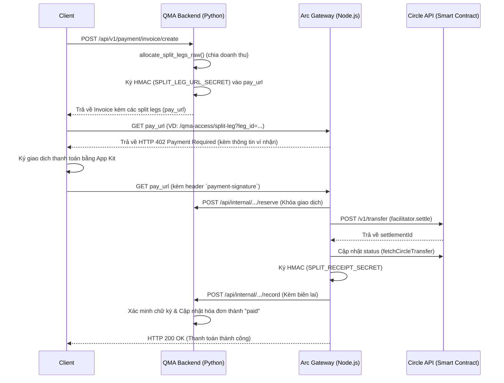
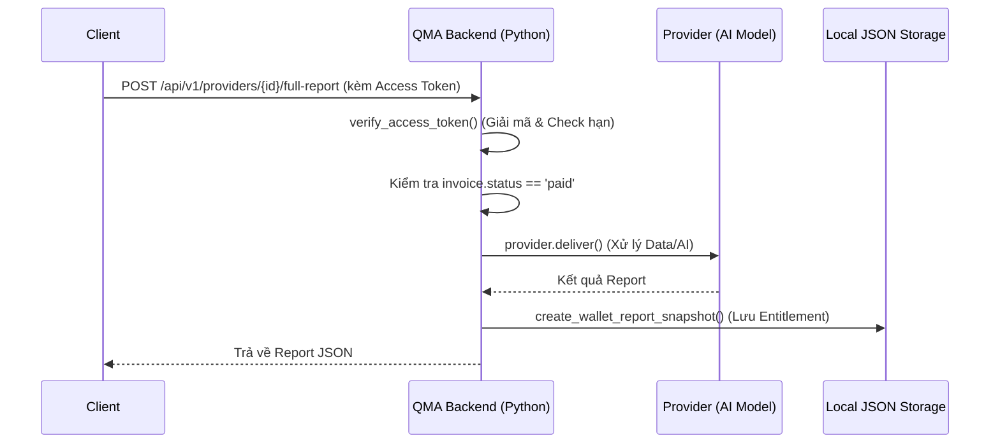
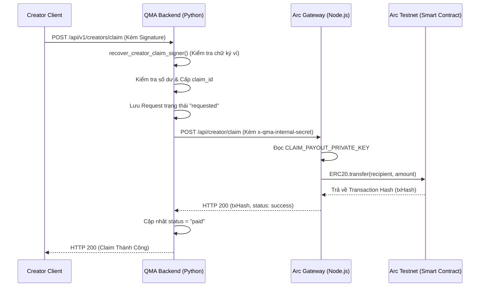

# 04. Data Flow Review

Báo cáo này mô hình hóa 3 quy trình cốt lõi của QMA (Report Purchase, Report Unlock, và Provider Payout). Mọi biểu đồ đều được xây dựng dựa trên mã nguồn đã đọc trực tiếp tại backend Python và `arc_gateway/server.ts`.

## 1. Report Purchase Flow (Quy trình mua báo cáo)
**Mô tả:** Luồng thanh toán trong QMA chủ yếu sử dụng cơ chế **Split-Leg** (chia % doanh thu tự động) thông qua giao thức HTTP 402.

**Phân tích Rủi ro (Security & Data Integrity):**
- Gateway `arc_gateway` và Backend giao tiếp thông qua HMAC Signature (`SPLIT_RECEIPT_SECRET`). Kẻ tấn công không thể giả mạo request gọi vào `/api/internal/.../record` để lừa Backend rằng hóa đơn đã thanh toán.
- Flow này triệt tiêu hoàn toàn Single Point of Failure về dòng tiền, vì USDC được chuyển **trực tiếp** vào ví của Creator (Provider) thông qua cơ chế Batching của Circle, không bị giam giữ tại Treasury của QMA.

## 2. Report Unlock Flow (Quy trình nhận báo cáo)
**Mô tả:** Sau khi hóa đơn được đánh dấu `paid`, Client dùng Access Token để yêu cầu giải mã báo cáo.

**Phân tích Rủi ro:**
- Quá trình này đã được phân tích kỹ ở Phase 3. Lỗi IDOR trên `chat.py` là ngoại lệ duy nhất; các luồng trả báo cáo gốc (`full-report`, `preview`) đều chặn đứng yêu cầu nếu token không hợp lệ (raise HTTP 403).
- **Điểm yếu kiến trúc:** File JSON Storage. Hàm `create_wallet_report_snapshot` lưu toàn bộ Entitlement vào file JSON cục bộ (`paid_reports.json`). Ở môi trường phân tán (Multi-node), việc ghi đè file có thể dẫn tới mất mát dữ liệu hoặc User A không thấy báo cáo đã mua ở Node B.

## 3. Provider Payout Flow (Quy trình Creator rút tiền)
**Mô tả:** Mặc dù luồng Split-Leg chuyển tiền trực tiếp, QMA vẫn hỗ trợ một cơ chế "Creator Claim" riêng biệt cho các khoản thu nhập không tách leg trực tiếp (vd: được gom lại hoặc từ các cơ chế thanh toán cũ).

### Cấu trúc luồng dữ liệu (Data Flow Architecture)
1. **Entry Point:** Giao diện frontend (Creator nhấn "Claim Earnings" và ký ví).
2. **API Endpoint:** `POST /api/v1/creators/claim` (trong `providers.py`).
3. **Service Layer:** `deps.recover_creator_claim_signer` (xác thực), `deps.allocate_creator_claim` (tính toán khấu trừ sổ cái), và gửi HTTP request nội bộ sang `arc_gateway/server.ts` (`POST /api/creator/claim`).
4. **Repository Layer:** `deps.get_creator_claims_db()` và `deps.save_creator_claim_record()`.
5. **Database Entities:** Bảng in-memory/JSON list `creator_claims_db`. Mỗi bản ghi chứa `claim_id`, `claimant_address`, `amount_usdc`, và `status`.
6. **State Transitions:** `requested` -> `paid` (thành công) hoặc `failed` (thất bại).
7. **Validation Points:**
   - Kiểm tra Signature có khớp với `claimant_address` không (ngăn chặn giả mạo).
   - Kiểm tra `requested_amount` <= `total_available` (tổng thu nhập trừ đi các claim `paid` và `pending`).
   - Kiểm tra `x-qma-internal-secret` giữa Backend và ArcGateway.
8. **Data Integrity Checks:** 
   - Số dư có thể rút (claimable) được tính toán động dựa trên tổng doanh thu (`earned_final`) trừ đi tổng các claim đã ghi nhận (`reserved_usdc = paid + pending`).

**Phân tích Rủi ro (DOUBLE SPEND VULNERABILITY):**
- Theo phân tích mã nguồn hàm `creator_claim_amounts()`, số dư đã rút (`reserved_usdc`) chỉ cộng dồn các claim có trạng thái `paid` hoặc `pending`. Các claim có trạng thái `failed` sẽ KHÔNG bị trừ vào tài khoản của Creator.
- **Lỗ hổng:** Giao tiếp giữa Backend và ArcGateway không có cơ chế đối soát (Reconciliation) hoặc Retry an toàn. Hàm `app.post("/api/creator/claim")` trên `arc_gateway/server.ts` thực thi transfer on-chain lập tức, không kiểm tra tính Idempotent của `claimId`.
- **Hậu quả (QMA bị rút ruột):** Nếu `arc_gateway` đẩy giao dịch lên blockchain thành công (Creator nhận được tiền), nhưng response HTTP trả về Backend bị timeout (do nghẽn mạng), Backend sẽ bắt `Exception`, đánh dấu claim thành `failed`. Do claim bị mark là `failed`, số dư khả dụng (`claimable`) của Creator tự động được khôi phục (rollback). Creator có thể tiếp tục ấn Claim để rút thêm tiền lần nữa cho tới khi ví Treasury cạn kiệt.
